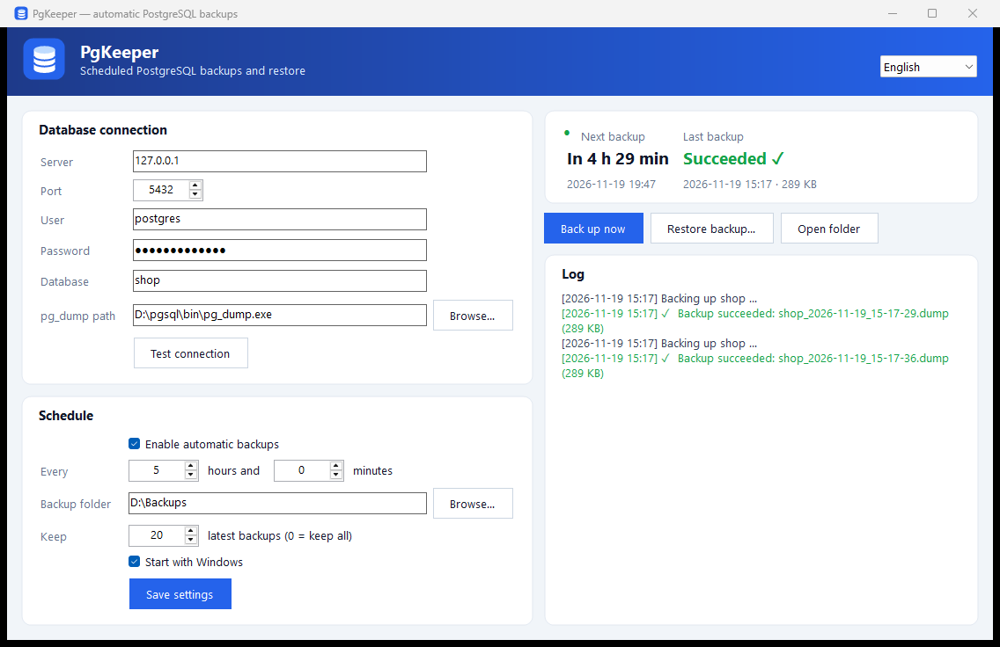
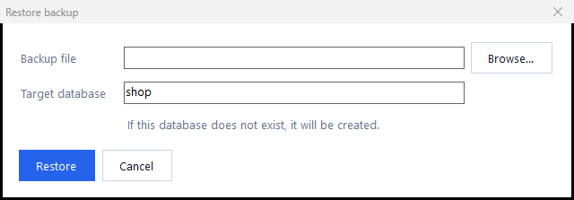
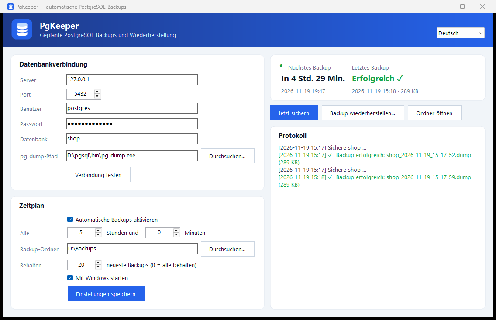
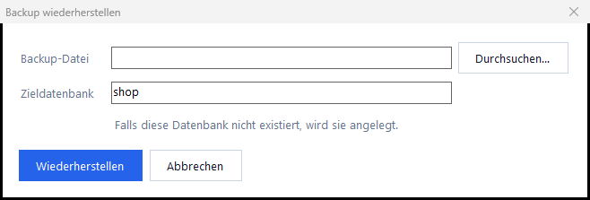
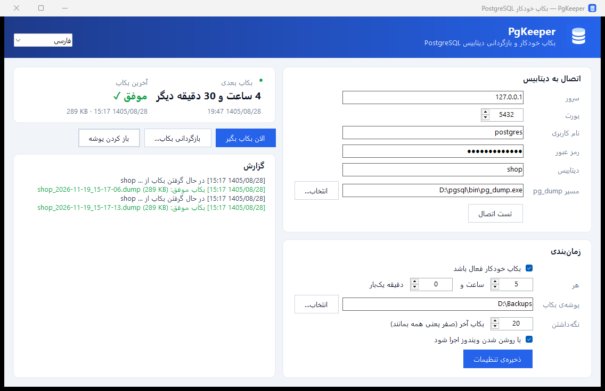
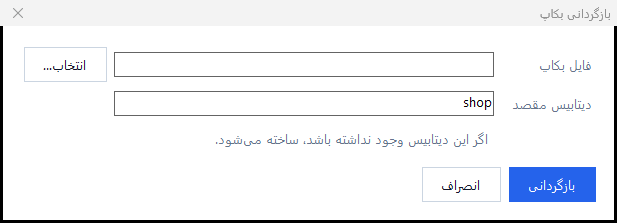

# PgKeeper

A tiny Windows app for **scheduled PostgreSQL backups** and **one-click restore**, in English, German and Persian.

برنامه‌ای کوچک برای ویندوز که از دیتابیس **PostgreSQL** طبق زمان‌بندی **بکاپ خودکار** می‌گیرد و هر وقت لازم شد آن را **بازگردانی** می‌کند.

Eine kleine Windows-App für **geplante PostgreSQL-Backups** und **Wiederherstellung per Klick**.



[⬇️ Download](../../releases/latest) · [English](#english) · [Deutsch](#deutsch) · [فارسی](#فارسی)

---

## English

### What is it?

PgKeeper is a small, free Windows app for anyone running **PostgreSQL on Windows** (desktop or Windows Server) who wants automatic backups every few hours, without writing scripts or paying for heavy backup software.

- A single ~150 KB exe. No installer.
- The actual backup is done by PostgreSQL's own `pg_dump`. PgKeeper runs it on schedule and keeps the files tidy.
- The interface is available in **English, German and Persian**. Switch it from the menu in the top corner; the window changes immediately.

### Features

- **Flexible schedule:** every *N hours and M minutes* (e.g. every 5 hours, or every 30 minutes).
- **Any backup folder:** files get timestamped names, e.g. `mydb_2026-11-17_14-00-01.dump`.
- **Retention:** keeps only the last *N* backups so the disk never fills up.
- **Back up now** button.
- **Restore:** pick a `.dump` file and a target database:
  - If the target database doesn't exist, it is created.
  - If it does exist, a **safety backup** of its current state is taken first.
  - The restore is **all-or-nothing** (single transaction): if anything fails, no tables are changed.

  

- **Connection test:** shows both the server version and the `pg_dump` version.
- **Tray icon:** closing the window keeps PgKeeper running next to the clock, and you get a notification if a backup fails.
- **Start with Windows** (optional).
- **Colour-coded log** of every backup and restore.

### Requirements

- **Windows 10/11 or Windows Server 2016+.** It needs .NET Framework 4.5+, which is already installed on these versions.
- **PostgreSQL client tools** (`pg_dump`, `pg_restore`, `psql`) on the machine running PgKeeper:
  - If PostgreSQL is installed on that machine, the tools are already there. PgKeeper finds them automatically in `C:\Program Files\PostgreSQL\<version>\bin`.
  - For a remote server, installing just the "Command Line Tools" component of the PostgreSQL installer is enough.
  - ⚠️ The tools must be the **same version or newer** than the database server.

### Getting started

1. Download `PgKeeper.zip` from [Releases](../../releases/latest) and extract it.
2. Run `PgKeeper.exe`. If SmartScreen warns you, click **More info**, then **Run anyway**. This only appears because the exe is not code-signed.
3. Choose your language in the top corner.
4. Enter the connection details (host, port, user, password, database) and click **Test connection**.
5. Set the interval and the backup folder, then tick **Enable automatic backups**.
6. Click **Save settings**. Done.

### Notes

- **Windows Server and RDP:** PgKeeper runs inside your user session. When you're done, close the Remote Desktop window with the X instead of signing out; signing out closes the app too.
- **Settings location:** settings live in `%APPDATA%\PgKeeper\settings.xml`. The password is encrypted with Windows DPAPI and can only be read by the same Windows user.
- **Backup format:** backups use `pg_dump`'s compressed custom format (`-F c`), so you can also restore them manually with `pg_restore`.
- **Before restoring,** it's best to stop whatever is using the database. If tables are locked, the restore stops with an error after 30 seconds instead of hanging.
- **Upgrading from HighBackup** (the app's earlier name): settings and the "start with Windows" option are carried over automatically on first start.

### Building from source

You don't need Visual Studio. The C# compiler that ships with Windows is enough:

```powershell
powershell -ExecutionPolicy Bypass -File build.ps1
```

This produces `PgKeeper.exe` next to `build.ps1`.

---

## Deutsch

### Was ist PgKeeper?

PgKeeper ist eine kleine, kostenlose Windows-App für alle, die **PostgreSQL unter Windows** betreiben (Desktop oder Windows Server) und alle paar Stunden automatische Backups möchten, ohne Skripte zu schreiben und ohne schwere, kostenpflichtige Backup-Software.

- Eine einzelne exe-Datei mit rund 150 KB. Keine Installation nötig.
- Das eigentliche Backup erledigt PostgreSQLs eigenes Werkzeug `pg_dump`. PgKeeper startet es nach Zeitplan und hält die Dateien in Ordnung.
- Die Oberfläche gibt es auf **Deutsch, Englisch und Persisch**. Die Sprache lässt sich oben in der Ecke umstellen; das Fenster wechselt sofort.



### Funktionen

- **Flexibler Zeitplan:** alle *N Stunden und M Minuten* (z. B. alle 5 Stunden oder alle 30 Minuten).
- **Beliebiger Backup-Ordner:** die Dateien erhalten einen Zeitstempel im Namen, z. B. `mydb_2026-11-17_14-00-01.dump`.
- **Aufbewahrung:** nur die letzten *N* Backups werden behalten, damit die Festplatte nicht vollläuft.
- Schaltfläche **Jetzt sichern**.
- **Wiederherstellung:** `.dump`-Datei und Zieldatenbank auswählen, den Rest erledigt PgKeeper:
  - Existiert die Zieldatenbank nicht, wird sie angelegt.
  - Existiert sie bereits, wird zuerst ein **Sicherheits-Backup** des aktuellen Stands erstellt.
  - Die Wiederherstellung läuft **ganz oder gar nicht** (eine einzige Transaktion): tritt ein Fehler auf, bleiben alle Tabellen unverändert.

  

- **Verbindungstest:** zeigt die Version des Servers und die von `pg_dump`.
- **Symbol im Infobereich:** wird das Fenster geschlossen, läuft PgKeeper neben der Uhr weiter. Schlägt ein Backup fehl, erscheint eine Benachrichtigung.
- **Mit Windows starten** (optional).
- **Farbiges Protokoll** aller Backups und Wiederherstellungen.

### Voraussetzungen

- **Windows 10/11 oder Windows Server 2016 und neuer.** Benötigt wird .NET Framework 4.5 oder neuer, das auf diesen Versionen bereits installiert ist.
- **PostgreSQL-Client-Werkzeuge** (`pg_dump`, `pg_restore`, `psql`) auf dem Rechner, auf dem PgKeeper läuft:
  - Ist PostgreSQL auf diesem Rechner installiert, sind die Werkzeuge bereits vorhanden. PgKeeper findet sie automatisch unter `C:\Program Files\PostgreSQL\<Version>\bin`.
  - Für einen entfernten Server genügt es, im PostgreSQL-Installer nur die Komponente „Command Line Tools“ zu installieren.
  - ⚠️ Die Werkzeuge müssen **dieselbe oder eine neuere Version** als der Datenbankserver haben.

### Erste Schritte

1. `PgKeeper.zip` unter [Releases](../../releases/latest) herunterladen und entpacken.
2. `PgKeeper.exe` starten. Falls SmartScreen warnt: **Weitere Informationen** und dann **Trotzdem ausführen** wählen. Die Warnung erscheint nur, weil die exe nicht digital signiert ist.
3. Oben in der Ecke **Deutsch** auswählen.
4. Verbindungsdaten eingeben (Server, Port, Benutzer, Passwort, Datenbank) und auf **Verbindung testen** klicken.
5. Intervall und Backup-Ordner festlegen und **Automatische Backups aktivieren** anhaken.
6. Auf **Einstellungen speichern** klicken. Fertig.

### Hinweise

- **Windows Server und Remotedesktop:** PgKeeper läuft in Ihrer Benutzersitzung. Wenn Sie fertig sind, schließen Sie das Remotedesktop-Fenster mit dem X und melden sich **nicht ab**; beim Abmelden wird auch die App beendet.
- **Speicherort der Einstellungen:** `%APPDATA%\PgKeeper\settings.xml`. Das Passwort wird mit Windows-DPAPI verschlüsselt und kann nur vom selben Windows-Benutzer gelesen werden.
- **Backup-Format:** komprimiertes Custom-Format von `pg_dump` (`-F c`). Die Dateien lassen sich auch manuell mit `pg_restore` wiederherstellen.
- **Vor einer Wiederherstellung** sollten Programme, die die Datenbank verwenden, beendet werden. Sind Tabellen gesperrt, bricht die Wiederherstellung nach 30 Sekunden mit einem Fehler ab, statt hängen zu bleiben.
- **Umstieg von HighBackup** (früherer Name der App): Einstellungen und die Option „Mit Windows starten“ werden beim ersten Start automatisch übernommen.

### Aus dem Quellcode bauen

Visual Studio ist nicht nötig. Der C#-Compiler, der bei Windows dabei ist, reicht aus:

```powershell
powershell -ExecutionPolicy Bypass -File build.ps1
```

Das Ergebnis ist `PgKeeper.exe` neben `build.ps1`.

---

<div dir="rtl">

## فارسی

### این برنامه چه کار می‌کند؟

اگر روی ویندوز (یا ویندوز سرور) دیتابیس PostgreSQL دارید و می‌خواهید هر چند ساعت یک‌بار خودکار از آن بکاپ گرفته شود، بدون اسکریپت‌نویسی و بدون نرم‌افزار سنگین و پولی، PgKeeper برای همین ساخته شده است.

- یک فایل exe حدود ۱۵۰ کیلوبایتی است و نصب لازم ندارد.
- کار بکاپ را همان ابزار رسمی `pg_dump` انجام می‌دهد. برنامه فقط سر وقت اجرایش می‌کند و فایل‌ها را مرتب نگه می‌دارد.
- رابط کاربری به سه زبان **فارسی، انگلیسی و آلمانی** است. زبان را از منوی گوشه‌ی بالای پنجره عوض کنید؛ پنجره همان لحظه تغییر می‌کند.



### امکانات

- **زمان‌بندی دلخواه:** هر چند ساعت و چند دقیقه یک‌بار، مثلاً هر ۵ ساعت یا هر ۳۰ دقیقه.
- **پوشه‌ی دلخواه:** فایل‌ها با اسم تاریخ‌دار ذخیره می‌شوند، مثل `mydb_2026-11-17_14-00-01.dump`.
- **پاک‌کردن خودکار:** فقط N بکاپ آخر نگه داشته می‌شود تا دیسک پر نشود.
- **دکمه‌ی «الان بکاپ بگیر»** برای بکاپ فوری.
- **بازگردانی (ریستور):** فایل بکاپ و دیتابیس مقصد را انتخاب می‌کنید و بقیه‌اش با برنامه است:
  - اگر دیتابیس مقصد وجود نداشته باشد، ساخته می‌شود.
  - اگر وجود داشته باشد، **اول یک بکاپ ایمنی** از وضعیت فعلی‌اش گرفته می‌شود.
  - بازگردانی به‌صورت **همه یا هیچ** انجام می‌شود؛ اگر وسط کار خطایی پیش بیاید، هیچ جدولی تغییر نمی‌کند.

  

- **تست اتصال:** نسخه‌ی دیتابیس و `pg_dump` را نشان می‌دهد.
- **کنار ساعت ویندوز:** با بستن پنجره، برنامه کنار ساعت ویندوز می‌ماند و بکاپ‌ها ادامه پیدا می‌کنند. اگر بکاپی ناموفق باشد، نوتیفیکیشن می‌دهد.
- **اجرای خودکار با روشن شدن ویندوز** (اختیاری).
- **گزارش رنگی** از همه‌ی بکاپ‌ها و بازگردانی‌ها، با تاریخ شمسی.

### پیش‌نیازها

- **ویندوز ۱۰ یا ۱۱، یا ویندوز سرور ۲۰۱۶ به بعد.** ‏.NET Framework 4.5 یا بالاتر لازم است که روی این نسخه‌ها از قبل نصب است.
- **ابزارهای PostgreSQL** (`pg_dump`، `pg_restore` و `psql`) روی همان سیستمی که برنامه اجرا می‌شود:
  - اگر PostgreSQL روی همان سیستم نصب است، این ابزارها هم نصب شده‌اند و برنامه خودش از مسیر `C:\Program Files\PostgreSQL\<نسخه>\bin` پیدایشان می‌کند.
  - اگر دیتابیس روی سرور دیگری است، نصب «Command Line Tools» از نصب‌کننده‌ی PostgreSQL کافی است.
  - ⚠️ نسخه‌ی این ابزارها باید **هم‌نسخه یا جدیدتر** از نسخه‌ی دیتابیس باشد.

### شروع کار

1. فایل `PgKeeper.zip` را از بخش [Releases](../../releases/latest) دانلود و از حالت فشرده خارج کنید.
2. `PgKeeper.exe` را اجرا کنید. اگر ویندوز پیغام SmartScreen نشان داد، روی **More info** و بعد **Run anyway** بزنید. این پیغام فقط به این خاطر است که فایل امضای دیجیتال ندارد.
3. از منوی گوشه‌ی بالا **فارسی** را انتخاب کنید.
4. اطلاعات اتصال را وارد کنید (سرور، پورت، نام کاربری، رمز و اسم دیتابیس) و **تست اتصال** را بزنید.
5. فاصله‌ی بکاپ‌ها و پوشه‌ی بکاپ را تعیین کنید و تیک **بکاپ خودکار فعال باشد** را بزنید.
6. **ذخیره‌ی تنظیمات** را بزنید. تمام!

### نکته‌های مهم

- **ویندوز سرور و ریموت دسکتاپ:** برنامه داخل نشست کاربر اجرا می‌شود. وقتی کارتان با سرور تمام شد، پنجره‌ی ریموت دسکتاپ را با ضربدر ببندید و **Sign out نکنید**؛ با Sign out برنامه هم بسته می‌شود.
- **جای تنظیمات:** تنظیمات در `%APPDATA%\PgKeeper\settings.xml` ذخیره می‌شوند. رمز عبور با DPAPI ویندوز رمزنگاری می‌شود و فقط همان کاربر ویندوز می‌تواند آن را باز کند.
- **فرمت بکاپ‌ها:** فایل‌ها با فرمت custom ابزار `pg_dump` (`-F c`) و به‌صورت فشرده ذخیره می‌شوند. اگر بخواهید، دستی هم با `pg_restore` قابل بازگردانی‌اند.
- **قبل از بازگردانی** بهتر است برنامه‌ای که از دیتابیس استفاده می‌کند خاموش باشد. اگر جدول‌ها قفل باشند، بازگردانی بعد از ۳۰ ثانیه با خطا متوقف می‌شود و برنامه هنگ نمی‌کند.
- **ارتقا از HighBackup** (اسم قبلی برنامه): تنظیمات و گزینه‌ی «اجرا با روشن شدن ویندوز» در اولین اجرا خودکار منتقل می‌شوند.

### ساخت از روی سورس

به Visual Studio نیازی نیست. کامپایلر C# همراه خود ویندوز کافی است:

```powershell
powershell -ExecutionPolicy Bypass -File build.ps1
```

خروجی، فایل `PgKeeper.exe` کنار `build.ps1` است.

</div>

---

## License

[MIT](LICENSE)
